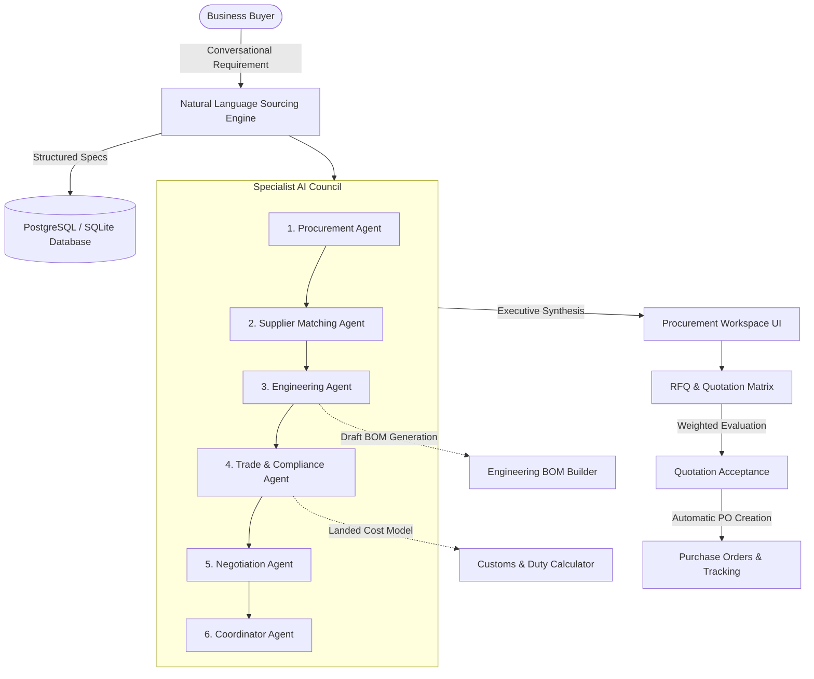

# Namade Kadda - Architecture Overview

## 1. System Vision & Paradigm
**Namade Kadda** is an explainable AI-powered B2B sourcing, procurement and manufacturing marketplace prototype. Instead of acting as a generic product catalog, it operates as an **explainable procurement workspace** structured around **6 specialist AI agent roles**:

---

## 2. Technical Stack
- **Frontend**: Next.js 16 (App Router), React 19, TypeScript, Tailwind CSS v4, Lucide Icons, Recharts.
- **Backend**: Python 3.14 / 3.11+, FastAPI, Pydantic v2 validation, Uvicorn ASGI server.
- **Database**: PostgreSQL (production) with SQLAlchemy 2.0 ORM, Alembic schema migrations, and universal SQLite zero-friction fallback for instant student development.
- **AI Orchestrator**: Modular Agent Orchestrator with deterministic demo adapter (zero API cost / zero credential requirement) and pluggable cloud LLM gateway (Groq, OpenAI, Gemini).
- **Testing**: pytest & pytest-asyncio for backend APIs; Next.js TypeScript static build & lint verification.

---

## 3. Specialist Agent Council
Each specialist agent performs a bounded task and outputs structured provenance metadata (Agent Name, Task, Inputs Used, Result, Assumptions, Warnings, Execution Mode, and Human Approval Flag):

1. **Procurement Agent**: Identifies sourcing strategies, batch size split recommendations, target price brackets, and evaluation weighting criteria.
2. **Supplier Matching Agent**: Performs structured queries against stored supplier capabilities, geographic locations, and catalog records.
3. **Engineering Agent**: Audits specification completeness (detecting missing tolerances, finishes, and standards) and synthesizes preliminary draft BOMs.
4. **Trade & Compliance Agent**: Evaluates candidate HS codes, estimated customs duties, IGST/VAT rates, and required import/export filing checklists.
5. **Negotiation Agent**: Formulates commercial counter-offers (volume discounts, delivery expedites, and payment term concessions) and analyzes trade-offs.
6. **Coordinator Agent**: Synthesizes intermediate deliverables into an executive briefing with numbered action items.

---

## 4. Data Security & Integrity
- **Untrusted Model Outputs**: All AI outputs are treated as untrusted suggestions requiring human confirmation before binding state changes.
- **Zero Execution Privileges**: Agents cannot execute arbitrary SQL queries or shell commands.
- **Secret Hygiene**: API keys are loaded via environment variables (`.env`) and never exposed to browser bundles or error logs.
